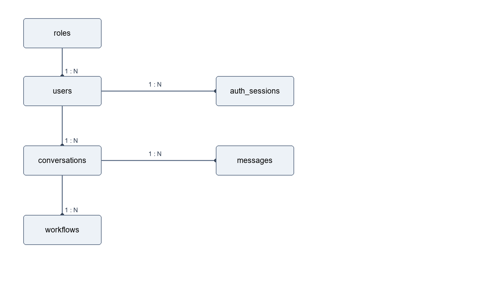
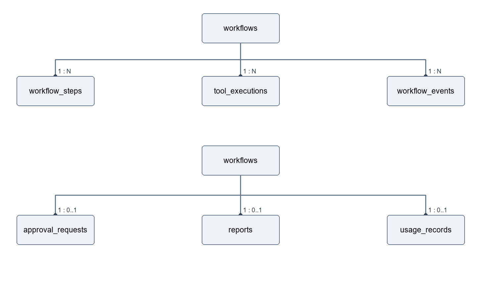
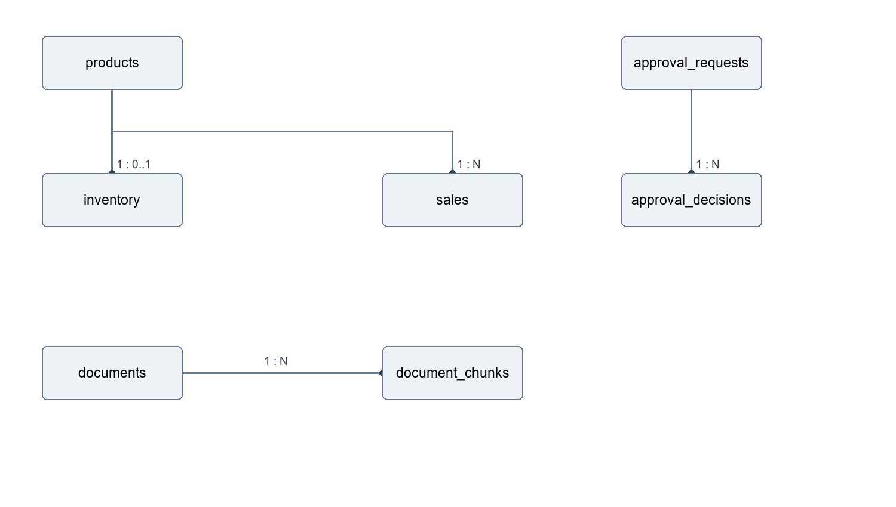

# Thiết kế cơ sở dữ liệu APBWAS

AI Powered Business Workflow Automation System

Phiên bản tài liệu 1.0  |  Ngày 31 tháng 10 năm 2026

Tài liệu mô tả cấu trúc lưu trữ và cách bảo đảm toàn vẹn dữ liệu của APBWAS để nhóm phát triển, kiểm thử và người đánh giá đồ án sử dụng khi triển khai, rà soát hoặc mở rộng hệ thống.

Thiết kế triển khai gồm 22 bảng ứng dụng, 143 cột và 21 khóa ngoại. PostgreSQL 16 lưu dữ liệu nghiệp vụ; pgvector hỗ trợ truy xuất tài liệu. Redis hỗ trợ cache và giới hạn sử dụng, còn hàng đợi bền vững nằm trong bảng jobs.

## 1 Phạm vi và cơ sở thiết kế

Phạm vi bao gồm danh tính, phân quyền, hội thoại, workflow Agent, hàng hóa, doanh số, tài liệu, phê duyệt, báo cáo, audit và vận hành. Mô tả bám theo mã nguồn hiện tại, bao gồm các thay đổi chưa commit tại thời điểm lập tài liệu; không phải biên bản kiểm tra schema của một database đang chạy.

| Thành phần | Thiết kế hiện tại |
| --- | --- |
| Database chính | PostgreSQL 16 với extension vector |
| ORM và migration | SQLAlchemy 2 và Alembic revisions 0001, 0002 |
| Định danh | UUID v4 lưu trong VARCHAR(36); audit_logs dùng INTEGER tự tăng |
| Thời gian | TIMESTAMP WITH TIME ZONE; ứng dụng chuẩn hóa về UTC |
| Số tiền | NUMERIC(15,0), đơn vị VND theo nghiệp vụ |
| Dữ liệu linh hoạt | JSON, không phải JSONB trong mapping hiện tại |
| Môi trường kiểm thử | SQLite; embedding dùng JSON thay cho VECTOR(384) |

Nguồn đối chiếu: backend/app/models.py; backend/app/db.py; backend/migrations/versions/0001_initial.py và 0002_approval_history.py; cùng mã xử lý approvals.py, workflows.py, audit.py, worker.py, permissions.py và retrieval.py. Commit nền là 768d4a0; bản mô tả schema tính cả working tree hiện tại.

## 2 Quy ước đọc tài liệu

PK là khóa chính; FK là khóa ngoại; UQ là duy nhất. Cột Null ghi Có khi cho phép NULL. Các giá trị mặc định ghi trong từ điển là mặc định ORM ở phía ứng dụng, không tự động trở thành DEFAULT trong PostgreSQL. Ngoại lệ liên quan migration 0002 được nêu riêng ở phần triển khai.

Quan hệ một tới nhiều cho phép phía con có không hoặc nhiều bản ghi. FK không NULL bắt buộc mỗi bản ghi con trỏ tới một bản ghi cha, nhưng không bắt buộc bản ghi cha phải có con. Các tham chiếu nằm trong JSON không có bảo đảm khóa ngoại.

## 3 Sơ đồ quan hệ dữ liệu

Sơ đồ được tách theo miền để dễ đọc. Các đường nối trong hình là quan hệ FK; con số thể hiện số lượng bản ghi phía con. Bảng đối chiếu ở mục 4 và tệp erd.mmd chứa toàn bộ 21 FK, gồm các liên kết người dùng được lược khỏi hình miền workflow và dữ liệu nghiệp vụ.

### 3 1 Danh tính và hội thoại

workflows.user_id cũng tham chiếu users.id. workflows.conversation_id cho phép NULL. permissions là danh mục độc lập; quyền gán cho vai trò được lưu trong roles.permissions.

### 3 2 Workflow và kết quả thực thi

Hai nút workflows trong hình cùng biểu diễn một bảng, được lặp lại để tách rõ hai nhóm quan hệ. approval_requests, reports và usage_records đều có workflow_id duy nhất; workflow có thể chưa có bản ghi tương ứng.

### 3 3 Hàng hóa tài liệu và phê duyệt

Các bảng audit_logs, system_settings và jobs không có FK. inventory.product_id là PK nên không có nhiều bản ghi tồn kho cho cùng sản phẩm. Không có bảng kho riêng trong thiết kế hiện tại.

## 4 Danh mục quan hệ khóa ngoại

| Cột tham chiếu | Cột đích | Null | ON DELETE |
| --- | --- | --- | --- |
| inventory.product_id | products.id | Không | NO ACTION |
| sales.product_id | products.id | Không | NO ACTION |
| users.role | roles.name | Không | NO ACTION |
| auth_sessions.user_id | users.id | Không | NO ACTION |
| conversations.user_id | users.id | Không | NO ACTION |
| documents.user_id | users.id | Không | NO ACTION |
| document_chunks.document_id | documents.id | Không | CASCADE |
| messages.conversation_id | conversations.id | Không | CASCADE |
| workflows.user_id | users.id | Không | NO ACTION |
| workflows.conversation_id | conversations.id | Có | NO ACTION |
| approval_requests.workflow_id | workflows.id | Không | NO ACTION |
| approval_requests.user_id | users.id | Không | NO ACTION |
| reports.workflow_id | workflows.id | Không | NO ACTION |
| reports.user_id | users.id | Không | NO ACTION |
| tool_executions.workflow_id | workflows.id | Không | NO ACTION |
| usage_records.user_id | users.id | Không | NO ACTION |
| usage_records.workflow_id | workflows.id | Không | NO ACTION |
| workflow_events.workflow_id | workflows.id | Không | NO ACTION |
| workflow_steps.workflow_id | workflows.id | Không | NO ACTION |
| approval_decisions.approval_id | approval_requests.id | Không | NO ACTION |
| approval_decisions.user_id | users.id | Không | NO ACTION |

NO ACTION là hành vi mặc định khi không khai báo ON DELETE. Không suy diễn xóa dây chuyền ngoài hai FK messages.conversation_id và document_chunks.document_id. Workflow hoặc các quan hệ khác còn tham chiếu có thể chặn xóa bản ghi cha.

## 5 Từ điển dữ liệu

Từ điển liệt kê đầy đủ 143 cột của 22 bảng ứng dụng. Bảng alembic_version là bảng hạ tầng của Alembic, không được tính vào số bảng ứng dụng.

### 5 1 Danh tính và phân quyền

#### roles

Vai trò và danh sách quyền được cấp. users.role tham chiếu roles.name; danh sách quyền nằm trong JSON permissions.

| Cột | Kiểu PostgreSQL | Null | Ý nghĩa và ràng buộc |
| --- | --- | --- | --- |
| name | VARCHAR(20) | Không | Tên hiển thị hoặc tên danh mục; PK |
| permissions | JSON | Không | Mảng mã quyền; mặc định [] |

#### permissions

Danh mục tên quyền. Schema hiện tại không có bảng nối role_permissions và không có khóa ngoại từ roles.permissions tới bảng này.

| Cột | Kiểu PostgreSQL | Null | Ý nghĩa và ràng buộc |
| --- | --- | --- | --- |
| name | VARCHAR(80) | Không | Tên hiển thị hoặc tên danh mục; PK |

#### users

Tài khoản người dùng và vai trò hiện hành. Mật khẩu được băm Argon2; trạng thái active được kiểm tra khi thực hiện nghiệp vụ.

| Cột | Kiểu PostgreSQL | Null | Ý nghĩa và ràng buộc |
| --- | --- | --- | --- |
| email | VARCHAR(180) | Không | Email đăng nhập; UQ |
| name | VARCHAR(120) | Không | Tên hiển thị hoặc tên danh mục |
| password_hash | TEXT | Không | Mật khẩu đã băm Argon2 |
| role | VARCHAR(20) | Không | Vai trò người dùng hoặc vai trò tin nhắn; FK roles.name |
| active | BOOLEAN | Không | Cho phép tài khoản hoạt động; mặc định True |
| id | VARCHAR(36) | Không | Định danh bản ghi; PK; mặc định UUID v4 |
| created_at | TIMESTAMPTZ | Không | Thời điểm tạo theo UTC; mặc định UTC hiện tại |

Ràng buộc bổ sung: UNIQUE (email).

#### auth_sessions

Phiên đăng nhập có thời hạn. Chỉ lưu SHA256 của token phiên; token gốc nằm trong cookie của trình duyệt.

| Cột | Kiểu PostgreSQL | Null | Ý nghĩa và ràng buộc |
| --- | --- | --- | --- |
| token_hash | VARCHAR(64) | Không | SHA256 token phiên; UQ |
| user_id | VARCHAR(36) | Không | Người dùng liên quan; FK users.id |
| expires_at | TIMESTAMPTZ | Không | Thời điểm hết hạn |
| id | VARCHAR(36) | Không | Định danh bản ghi; PK; mặc định UUID v4 |
| created_at | TIMESTAMPTZ | Không | Thời điểm tạo theo UTC; mặc định UTC hiện tại |

Ràng buộc bổ sung: UNIQUE (token_hash).

### 5 2 Hội thoại và thực thi Agent

#### conversations

Hội thoại thuộc một người dùng; context lưu ngữ cảnh nghiệp vụ cho các lượt yêu cầu tiếp theo.

| Cột | Kiểu PostgreSQL | Null | Ý nghĩa và ràng buộc |
| --- | --- | --- | --- |
| user_id | VARCHAR(36) | Không | Người dùng liên quan; FK users.id |
| title | VARCHAR(120) | Không | Tiêu đề |
| context | JSON | Không | Ngữ cảnh hội thoại dạng JSON; mặc định {} |
| id | VARCHAR(36) | Không | Định danh bản ghi; PK; mặc định UUID v4 |
| created_at | TIMESTAMPTZ | Không | Thời điểm tạo theo UTC; mặc định UTC hiện tại |

#### messages

Tin nhắn trong hội thoại. Xóa hội thoại sẽ xóa các tin nhắn theo khóa ngoại CASCADE, nếu thao tác xóa hội thoại được các quan hệ khác cho phép.

| Cột | Kiểu PostgreSQL | Null | Ý nghĩa và ràng buộc |
| --- | --- | --- | --- |
| conversation_id | VARCHAR(36) | Không | Hội thoại liên quan; FK conversations.id |
| role | VARCHAR(20) | Không | Vai trò người dùng hoặc vai trò tin nhắn |
| content | TEXT | Không | Nội dung văn bản |
| id | VARCHAR(36) | Không | Định danh bản ghi; PK; mặc định UUID v4 |
| created_at | TIMESTAMPTZ | Không | Thời điểm tạo theo UTC; mặc định UTC hiện tại |

#### workflows

Yêu cầu nghiệp vụ, kế hoạch Agent, kết quả và tiến độ thực thi. idempotency_key ngăn tạo lặp; checkpoint hỗ trợ tiếp tục từ bước đã lưu.

| Cột | Kiểu PostgreSQL | Null | Ý nghĩa và ràng buộc |
| --- | --- | --- | --- |
| user_id | VARCHAR(36) | Không | Người dùng liên quan; FK users.id |
| conversation_id | VARCHAR(36) | Có | Hội thoại liên quan; FK conversations.id |
| request | TEXT | Không | Yêu cầu nghiệp vụ gốc |
| status | VARCHAR(30) | Không | Trạng thái xử lý do ứng dụng quản lý; mặc định queued |
| plan | JSON | Không | Danh sách bước và tham số công cụ; mặc định [] |
| result | JSON | Không | Kết quả có cấu trúc; mặc định {} |
| error | TEXT | Có | Thông báo lỗi nếu có |
| checkpoint | INTEGER | Không | Số bước đã hoàn thành; mặc định 0 |
| tokens | INTEGER | Không | Số token ghi nhận; mặc định 0 |
| duration_ms | INTEGER | Không | Thời gian xử lý theo mili giây; mặc định 0 |
| cancel_requested | BOOLEAN | Không | Cờ yêu cầu hủy; mặc định False |
| idempotency_key | VARCHAR(100) | Không | Khóa chống tạo trùng yêu cầu; UQ |
| deadline | TIMESTAMPTZ | Có | Hạn xử lý workflow |
| id | VARCHAR(36) | Không | Định danh bản ghi; PK; mặc định UUID v4 |
| created_at | TIMESTAMPTZ | Không | Thời điểm tạo theo UTC; mặc định UTC hiện tại |

Ràng buộc bổ sung: UNIQUE (idempotency_key).

#### workflow_steps

Danh sách bước thực thi có vị trí và trạng thái. Mỗi workflow chỉ có một bản ghi cho một position.

| Cột | Kiểu PostgreSQL | Null | Ý nghĩa và ràng buộc |
| --- | --- | --- | --- |
| workflow_id | VARCHAR(36) | Không | Workflow liên quan; FK workflows.id |
| position | INTEGER | Không | Vị trí bước hoặc đoạn văn bản |
| tool | VARCHAR(80) | Không | Tên công cụ trong allowlist |
| status | VARCHAR(30) | Không | Trạng thái xử lý do ứng dụng quản lý; mặc định queued |
| output | JSON | Không | Kết quả thực thi JSON; mặc định {} |
| id | VARCHAR(36) | Không | Định danh bản ghi; PK; mặc định UUID v4 |
| created_at | TIMESTAMPTZ | Không | Thời điểm tạo theo UTC; mặc định UTC hiện tại |

Ràng buộc bổ sung: UNIQUE (workflow_id, position).

#### tool_executions

Lịch sử gọi công cụ với arguments, output và thời gian thực thi. Lưu dữ liệu có cấu trúc để kiểm tra lại kết quả.

| Cột | Kiểu PostgreSQL | Null | Ý nghĩa và ràng buộc |
| --- | --- | --- | --- |
| workflow_id | VARCHAR(36) | Không | Workflow liên quan; FK workflows.id |
| position | INTEGER | Không | Vị trí bước hoặc đoạn văn bản |
| tool | VARCHAR(80) | Không | Tên công cụ trong allowlist |
| arguments | JSON | Không | Tham số nghiệp vụ JSON |
| output | JSON | Không | Kết quả thực thi JSON |
| duration_ms | INTEGER | Không | Thời gian xử lý theo mili giây |
| id | VARCHAR(36) | Không | Định danh bản ghi; PK; mặc định UUID v4 |
| created_at | TIMESTAMPTZ | Không | Thời điểm tạo theo UTC; mặc định UTC hiện tại |

Ràng buộc bổ sung: UNIQUE (workflow_id, position).

#### workflow_events

Dòng sự kiện dùng cho SSE và phát lại. sequence tăng trên toàn hệ thống, không phải số thứ tự riêng của mỗi workflow.

| Cột | Kiểu PostgreSQL | Null | Ý nghĩa và ràng buộc |
| --- | --- | --- | --- |
| sequence | INTEGER | Không | Thứ tự sự kiện toàn hệ thống; UQ |
| workflow_id | VARCHAR(36) | Không | Workflow liên quan; FK workflows.id |
| type | VARCHAR(50) | Không | Loại sự kiện hoặc báo cáo |
| payload | JSON | Không | Dữ liệu sự kiện JSON |
| id | VARCHAR(36) | Không | Định danh bản ghi; PK; mặc định UUID v4 |
| created_at | TIMESTAMPTZ | Không | Thời điểm tạo theo UTC; mặc định UTC hiện tại |

### 5 3 Dữ liệu hàng hóa

#### products

Danh mục hàng hóa gồm SKU, tên, danh mục và giá bán. Đây là nguồn tra giá của công cụ lookup_products; giá không lấy từ tài liệu nội bộ.

| Cột | Kiểu PostgreSQL | Null | Ý nghĩa và ràng buộc |
| --- | --- | --- | --- |
| sku | VARCHAR(30) | Không | Mã hàng hóa duy nhất; UQ |
| name | VARCHAR(120) | Không | Tên hiển thị hoặc tên danh mục |
| category | VARCHAR(80) | Không | Danh mục sản phẩm dạng chuỗi |
| price | NUMERIC(15, 0) | Không | Giá bán VND không có phần thập phân |
| id | VARCHAR(36) | Không | Định danh bản ghi; PK; mặc định UUID v4 |
| created_at | TIMESTAMPTZ | Không | Thời điểm tạo theo UTC; mặc định UTC hiện tại |

Ràng buộc bổ sung: UNIQUE (sku).

#### inventory

Tồn kho hiện tại cho từng sản phẩm. product_id vừa là khóa chính vừa là khóa ngoại; version phục vụ khóa lạc quan khi phê duyệt cập nhật.

| Cột | Kiểu PostgreSQL | Null | Ý nghĩa và ràng buộc |
| --- | --- | --- | --- |
| product_id | VARCHAR(36) | Không | Sản phẩm liên quan; PK, FK products.id |
| quantity | INTEGER | Không | Số lượng hàng |
| threshold | INTEGER | Không | Ngưỡng cảnh báo tồn kho thấp; mặc định 20 |
| version | INTEGER | Không | Phiên bản tồn kho phục vụ kiểm soát đồng thời; mặc định 1 |

Ràng buộc bổ sung: CHECK (quantity >= 0).

#### sales

Bản ghi doanh số gắn với sản phẩm và thời điểm. revenue là giá trị doanh thu đã lưu; báo cáo không suy ngược doanh thu từ giá bán hiện tại.

| Cột | Kiểu PostgreSQL | Null | Ý nghĩa và ràng buộc |
| --- | --- | --- | --- |
| product_id | VARCHAR(36) | Không | Sản phẩm liên quan; FK products.id |
| date | TIMESTAMPTZ | Không | Thời điểm ghi nhận doanh số |
| quantity | INTEGER | Không | Số lượng hàng |
| revenue | NUMERIC(15, 0) | Không | Doanh thu VND không có phần thập phân |
| id | VARCHAR(36) | Không | Định danh bản ghi; PK; mặc định UUID v4 |
| created_at | TIMESTAMPTZ | Không | Thời điểm tạo theo UTC; mặc định UTC hiện tại |

### 5 4 Tài liệu và truy xuất

#### documents

Thông tin tài liệu tải lên, phạm vi truy cập, nội dung trích xuất và trạng thái lập chỉ mục. Tệp gốc nằm trong kho uploads; database giữ đường dẫn.

| Cột | Kiểu PostgreSQL | Null | Ý nghĩa và ràng buộc |
| --- | --- | --- | --- |
| user_id | VARCHAR(36) | Không | Người dùng liên quan; FK users.id |
| name | VARCHAR(250) | Không | Tên hiển thị hoặc tên danh mục |
| status | VARCHAR(30) | Không | Trạng thái xử lý do ứng dụng quản lý; mặc định uploaded |
| scope | VARCHAR(30) | Không | Phạm vi tài liệu all hoặc vai trò; mặc định all |
| path | TEXT | Có | Đường dẫn tệp gốc |
| content | TEXT | Không | Nội dung văn bản; mặc định chuỗi rỗng |
| chunks | INTEGER | Không | Số đoạn đã lập chỉ mục; mặc định 0 |
| error | TEXT | Có | Thông báo lỗi nếu có |
| id | VARCHAR(36) | Không | Định danh bản ghi; PK; mặc định UUID v4 |
| created_at | TIMESTAMPTZ | Không | Thời điểm tạo theo UTC; mặc định UTC hiện tại |

#### document_chunks

Các đoạn văn bản và embedding 384 chiều. model xác định cách tạo vector; truy xuất lọc model và phạm vi tài liệu trước khi trả kết quả.

| Cột | Kiểu PostgreSQL | Null | Ý nghĩa và ràng buộc |
| --- | --- | --- | --- |
| document_id | VARCHAR(36) | Không | Tài liệu nguồn; FK documents.id |
| content | TEXT | Không | Nội dung văn bản |
| page | INTEGER | Có | Số trang nguồn nếu xác định được |
| position | INTEGER | Không | Vị trí bước hoặc đoạn văn bản |
| embedding | VECTOR(384) | Không | Vector 384 chiều |
| model | VARCHAR(120) | Không | Định danh mô hình hoặc bộ mã hóa embedding |
| id | VARCHAR(36) | Không | Định danh bản ghi; PK; mặc định UUID v4 |
| created_at | TIMESTAMPTZ | Không | Thời điểm tạo theo UTC; mặc định UTC hiện tại |

### 5 5 Phê duyệt và báo cáo

#### approval_requests

Yêu cầu phê duyệt của một workflow. arguments chứa tham số đề xuất và phiên bản tồn kho; revision quản lý các lần sửa trước khi duyệt.

| Cột | Kiểu PostgreSQL | Null | Ý nghĩa và ràng buộc |
| --- | --- | --- | --- |
| workflow_id | VARCHAR(36) | Không | Workflow liên quan; UQ, FK workflows.id |
| user_id | VARCHAR(36) | Không | Người dùng liên quan; FK users.id |
| status | VARCHAR(30) | Không | Trạng thái xử lý do ứng dụng quản lý; mặc định pending |
| tool | VARCHAR(80) | Không | Tên công cụ trong allowlist; mặc định apply_approved_inventory_adjustment |
| arguments | JSON | Không | Tham số nghiệp vụ JSON |
| revision | INTEGER | Không | Phiên bản yêu cầu phê duyệt; mặc định 1 |
| approved_revision | INTEGER | Có | Phiên bản đã được duyệt |
| expires_at | TIMESTAMPTZ | Không | Thời điểm hết hạn |
| reason | TEXT | Không | Lý do hoặc giải thích; mặc định Hành động ghi thay đổi tồn kho cần phê duyệt. |
| id | VARCHAR(36) | Không | Định danh bản ghi; PK; mặc định UUID v4 |
| created_at | TIMESTAMPTZ | Không | Thời điểm tạo theo UTC; mặc định UTC hiện tại |

Ràng buộc bổ sung: UNIQUE (workflow_id).

#### approval_decisions

Lịch sử quyết định của người duyệt theo revision. arguments lưu ảnh chụp tham số trước và sau quyết định.

| Cột | Kiểu PostgreSQL | Null | Ý nghĩa và ràng buộc |
| --- | --- | --- | --- |
| approval_id | VARCHAR(36) | Không | Yêu cầu phê duyệt liên quan; FK approval_requests.id |
| user_id | VARCHAR(36) | Không | Người dùng liên quan; FK users.id |
| revision | INTEGER | Không | Phiên bản yêu cầu phê duyệt |
| decision | VARCHAR(20) | Không | Quyết định approved rejected hoặc revision |
| reason | TEXT | Không | Lý do hoặc giải thích; mặc định chuỗi rỗng |
| arguments | JSON | Không | Tham số nghiệp vụ JSON; mặc định {} |
| id | VARCHAR(36) | Không | Định danh bản ghi; PK; mặc định UUID v4 |
| created_at | TIMESTAMPTZ | Không | Thời điểm tạo theo UTC; mặc định UTC hiện tại |

#### reports

Báo cáo đã tạo từ workflow. workflow_id duy nhất giúp việc tạo báo cáo có thể thực hiện lại mà không nhân đôi báo cáo.

| Cột | Kiểu PostgreSQL | Null | Ý nghĩa và ràng buộc |
| --- | --- | --- | --- |
| workflow_id | VARCHAR(36) | Không | Workflow liên quan; UQ, FK workflows.id |
| user_id | VARCHAR(36) | Không | Người dùng liên quan; FK users.id |
| title | VARCHAR(200) | Không | Tiêu đề |
| type | VARCHAR(30) | Không | Loại sự kiện hoặc báo cáo; mặc định revenue |
| data | JSON | Không | Nội dung báo cáo JSON |
| id | VARCHAR(36) | Không | Định danh bản ghi; PK; mặc định UUID v4 |
| created_at | TIMESTAMPTZ | Không | Thời điểm tạo theo UTC; mặc định UTC hiện tại |

Ràng buộc bổ sung: UNIQUE (workflow_id).

### 5 6 Vận hành và kiểm toán

#### audit_logs

Nhật ký sự kiện nối chuỗi bằng HMAC SHA256. actor, resource và correlation_id là chuỗi định danh, không phải khóa ngoại.

| Cột | Kiểu PostgreSQL | Null | Ý nghĩa và ràng buộc |
| --- | --- | --- | --- |
| id | INTEGER | Không | Định danh bản ghi; PK; tự tăng |
| created_at | TIMESTAMPTZ | Không | Thời điểm tạo theo UTC; mặc định UTC hiện tại |
| actor | VARCHAR(80) | Không | ID người dùng hoặc tác nhân hệ thống |
| event | VARCHAR(80) | Không | Mã sự kiện audit |
| resource | VARCHAR(80) | Không | Định danh tài nguyên nghiệp vụ |
| correlation_id | VARCHAR(80) | Không | Định danh liên kết chuỗi xử lý |
| payload | JSON | Không | Dữ liệu sự kiện JSON |
| previous_hash | VARCHAR(64) | Không | HMAC của bản ghi audit trước |
| hash | VARCHAR(64) | Không | HMAC của bản ghi audit hiện tại |

#### usage_records

Số token được ghi nhận cho người dùng theo workflow. Một workflow có tối đa một bản ghi sử dụng.

| Cột | Kiểu PostgreSQL | Null | Ý nghĩa và ràng buộc |
| --- | --- | --- | --- |
| user_id | VARCHAR(36) | Không | Người dùng liên quan; FK users.id |
| workflow_id | VARCHAR(36) | Không | Workflow liên quan; UQ, FK workflows.id |
| tokens | INTEGER | Không | Số token ghi nhận; mặc định 0 |
| id | VARCHAR(36) | Không | Định danh bản ghi; PK; mặc định UUID v4 |
| created_at | TIMESTAMPTZ | Không | Thời điểm tạo theo UTC; mặc định UTC hiện tại |

Ràng buộc bổ sung: UNIQUE (workflow_id).

#### system_settings

Cấu hình ứng dụng theo khóa, ví dụ giới hạn sử dụng, bật tắt công cụ và heartbeat của worker. Giá trị lưu dưới dạng JSON.

| Cột | Kiểu PostgreSQL | Null | Ý nghĩa và ràng buộc |
| --- | --- | --- | --- |
| key | VARCHAR(80) | Không | Khóa cấu hình; PK |
| value | JSON | Không | Giá trị cấu hình JSON |

#### jobs

Hàng đợi bền vững cho workflow hoặc lập chỉ mục tài liệu. resource là tham chiếu đa hình do ứng dụng phân giải; không có khóa ngoại.

| Cột | Kiểu PostgreSQL | Null | Ý nghĩa và ràng buộc |
| --- | --- | --- | --- |
| resource | VARCHAR(36) | Không | Định danh tài nguyên nghiệp vụ; UQ |
| kind | VARCHAR(20) | Không | Loại công việc workflow hoặc document |
| status | VARCHAR(20) | Không | Trạng thái xử lý do ứng dụng quản lý; mặc định queued |
| lease_until | TIMESTAMPTZ | Có | Hạn giữ quyền xử lý job |
| id | VARCHAR(36) | Không | Định danh bản ghi; PK; mặc định UUID v4 |
| created_at | TIMESTAMPTZ | Không | Thời điểm tạo theo UTC; mặc định UTC hiện tại |

Ràng buộc bổ sung: UNIQUE (resource).

## 6 Chỉ mục và tối ưu truy vấn

Các PK và UNIQUE tạo chỉ mục hỗ trợ tương ứng trong PostgreSQL. Các chỉ mục đơn được mapping khai báo như sau; tên cột không có trong danh sách không được coi là đã có index chỉ vì là khóa ngoại.

| Bảng | Chỉ mục tường minh theo cột |
| --- | --- |
| audit_logs | (correlation_id); (created_at); (event) |
| jobs | (created_at); (status) |
| products | (created_at) |
| sales | (created_at); (date); (product_id) |
| users | (created_at) |
| auth_sessions | (created_at); (user_id) |
| conversations | (created_at); (user_id) |
| documents | (created_at); (status) |
| document_chunks | (created_at); (document_id); (model) |
| messages | (conversation_id); (created_at) |
| workflows | (created_at); (status); (user_id) |
| approval_requests | (created_at); (status) |
| reports | (created_at); (user_id) |
| tool_executions | (created_at); (workflow_id) |
| usage_records | (created_at); (user_id) |
| workflow_events | (created_at); (sequence) UNIQUE; (workflow_id) |
| workflow_steps | (created_at); (workflow_id) |
| approval_decisions | (approval_id); (created_at) |

Migration 0001 tạo thêm document_chunks_vector_idx bằng HNSW trên embedding với vector_cosine_ops. Truy xuất tài liệu lọc trạng thái, scope và model, sau đó lấy tối đa 5 kết quả theo cosine distance. Hiệu quả thực tế cần đo bằng EXPLAIN ANALYZE trên bộ dữ liệu triển khai.

Đề xuất khi dữ liệu tăng: đánh giá index ghép sales(product_id, date), workflows(user_id, created_at) và jobs(status, created_at). Tìm tên hàng bằng ILIKE có ký tự đại diện đầu chuỗi cần cân nhắc pg_trgm. Đây là đề xuất mở rộng, chưa phải chỉ mục có sẵn trong schema.

## 7 Quy tắc nghiệp vụ và giao dịch

### 7 1 Tra cứu dữ liệu hàng hóa

Công cụ lookup_products đọc products bằng tên, SKU, danh mục hoặc product_id, ưu tiên tên hoặc SKU khớp chính xác. Kết quả có tối đa 20 sản phẩm và giá lấy trực tiếp từ products.price. Nếu nhiều kết quả phù hợp, câu trả lời liệt kê lựa chọn để người dùng xác định sản phẩm. Dữ liệu tồn kho lấy từ inventory, còn doanh thu lấy từ sales.

Agent không cung cấp câu SQL tự do. Với PostgreSQL, truy vấn đọc được thực hiện trong transaction READ ONLY với statement_timeout 2500 ms. AGENT_DATABASE_URL có thể cấu hình kết nối đọc riêng; khi không cấu hình, hệ thống dùng cùng engine nhưng vẫn thiết lập transaction chỉ đọc.

### 7 2 Phê duyệt điều chỉnh tồn kho

Bước đề xuất lưu product_id, quantity, before và version trong approval_requests.arguments mà chưa thay đổi tồn kho. Người duyệt phải có quyền phù hợp; yêu cầu còn pending, đúng revision và chưa hết hạn.

Khi phê duyệt, ứng dụng khóa yêu cầu phê duyệt và workflow bằng SELECT FOR UPDATE, sau đó cập nhật inventory với điều kiện version trùng giá trị đề xuất. Câu UPDATE tăng version thêm một. Nếu số dòng cập nhật khác một, thao tác bị từ chối do xung đột. Tồn kho, trạng thái phê duyệt, quyết định, audit và sự kiện được commit trong cùng giao dịch xử lý quyết định.

### 7 3 Khôi phục workflow và xử lý job

workflows.idempotency_key, các UNIQUE(workflow_id, position), checkpoint và workflow_id duy nhất ở bảng báo cáo hỗ trợ chống nhân đôi và tiếp tục xử lý. Đây là cơ chế idempotency cho các thao tác đã triển khai, không phải bảo đảm exactly once cho mọi công cụ hoặc dịch vụ ngoài hệ thống.

Worker lấy job bằng FOR UPDATE SKIP LOCKED; lease_until cho phép nhận lại job running khi quá hạn giữ quyền. jobs.resource duy nhất ngăn tạo nhiều job cho cùng chuỗi định danh tài nguyên. Worker cập nhật heartbeat trong system_settings và tự chuyển các yêu cầu phê duyệt quá hạn sang expired.

### 7 4 Audit và thứ tự sự kiện

Audit dùng khóa advisory theo transaction để tuần tự hóa chuỗi HMAC. previous_hash nối tới bản ghi trước; hàm kiểm tra tính lại chuỗi từ đầu. Trigger PostgreSQL chặn UPDATE và DELETE từng dòng trên audit_logs. Trigger này không chặn TRUNCATE và không thay thế phân quyền database hay bảo vệ khóa HMAC.

workflow_events.sequence là giá trị duy nhất toàn hệ thống. Ứng dụng cấp số từ MAX(sequence) cộng một dưới khóa advisory trong PostgreSQL, hỗ trợ client nối lại stream từ sự kiện đã nhận. Đây không phải cột identity tự tăng của PostgreSQL.

## 8 Toàn vẹn dữ liệu và bảo mật

Ràng buộc DB hiện có gồm PK, FK, UNIQUE và CHECK inventory.quantity >= 0. Các cột trạng thái, loại quyết định, scope và mã công cụ là VARCHAR, không phải PostgreSQL ENUM; giá trị hợp lệ chủ yếu được kiểm tra trong schema API và mã nghiệp vụ.

Không có CHECK database cho products.price >= 0, sales.quantity >= 0, sales.revenue >= 0, inventory.threshold >= 0 hoặc inventory.version >= 1. Nếu mở thêm đường ghi dữ liệu hoặc tích hợp nhập dữ liệu, cần bổ sung validation và cân nhắc migration thêm CHECK trước khi đưa vào vận hành.

roles.permissions lưu mảng quyền JSON để ứng dụng kiểm tra RBAC; chưa có khóa ngoại kiểm chứng từng mã quyền. documents.scope được lọc ở ứng dụng. Thiết kế hiện tại chưa triển khai PostgreSQL row level security; quyền truy cập dữ liệu phụ thuộc vào backend và quyền tài khoản database.

Không lưu API key của nhà cung cấp AI trong bảng nghiệp vụ. Biến môi trường chứa bí mật phải được quản lý ngoài Git. auth_sessions chỉ lưu token hash; audit che các khóa payload nhạy cảm trước khi băm và ghi log. Lịch sử yêu cầu, kết quả công cụ và tài liệu có thể chứa dữ liệu nghiệp vụ, vì vậy cần hạn chế truy cập và có chính sách lưu giữ phù hợp.

## 9 Migration sao lưu và khôi phục

Revision 0001 tạo extension vector, bảng và index từ metadata, thêm HNSW index và trigger audit. Revision 0002 bổ sung approval_decisions.arguments nếu cột chưa tồn tại; nhánh thêm cột đặt server default JSON rỗng. Cài đặt mới lấy metadata hiện tại có thể đã có cột nên bỏ qua nhánh này; server default của cột có thể khác giữa database nâng cấp và cài mới.

Lệnh triển khai chuẩn là alembic upgrade head từ thư mục backend. Vì 0001 tham chiếu metadata hiện tại, cần viết migration mới tường minh cho mọi thay đổi tiếp theo; chỉ sửa models.py không cập nhật một database đã áp dụng revision 0001. schema-reference.sql đi kèm là bản tham khảo cấu trúc, không thay thế lịch sử migration và không nên chạy chồng vào database hiện có.

Khuyến nghị vận hành: sao lưu PostgreSQL bằng pg_dump, sao lưu riêng uploads và khóa audit ngoài database; mã hóa bản sao và kiểm soát quyền truy cập. Khôi phục sang môi trường tách biệt, chạy kiểm tra FK, đối chiếu số bản ghi, xác minh chuỗi audit và thử tra giá, tạo workflow, lập chỉ mục cùng luồng phê duyệt. Lịch sao lưu, thời hạn giữ và mục tiêu RPO RTO cần do nhóm vận hành chốt; mã nguồn hiện tại chưa cung cấp lịch sao lưu tự động.

## 10 Chuẩn hóa và hướng mở rộng

Các thực thể người dùng, sản phẩm, tồn kho, doanh số, workflow và quyết định phê duyệt được tách theo trách nhiệm và kết nối bằng khóa ngoại. JSON được dùng có chủ đích cho cấu trúc linh hoạt như kế hoạch, tham số, kết quả và quyền; nội dung bên trong JSON không được database kiểm tra quan hệ như các cột FK.

Danh mục sản phẩm hiện là chuỗi products.category; chưa có bảng category, kho, đơn hàng hay chi tiết đơn hàng. sales là bản ghi doanh số phục vụ báo cáo, không phải mô hình kế toán hoặc đơn hàng hoàn chỉnh. Khi cần quản lý nhiều kho, cần thêm warehouses và khóa ghép tồn kho theo kho và sản phẩm bằng migration phù hợp.

Ưu tiên mở rộng gồm chuẩn hóa role_permissions khi cần ràng buộc quyền chặt hơn, bổ sung CHECK cho đường ghi tài chính, tách snapshot và dữ liệu JSON lớn nếu truy vấn thường xuyên, đánh giá chỉ mục ghép bằng số liệu và thiết lập chính sách lưu giữ cho session, event, audit và tệp tải lên.
