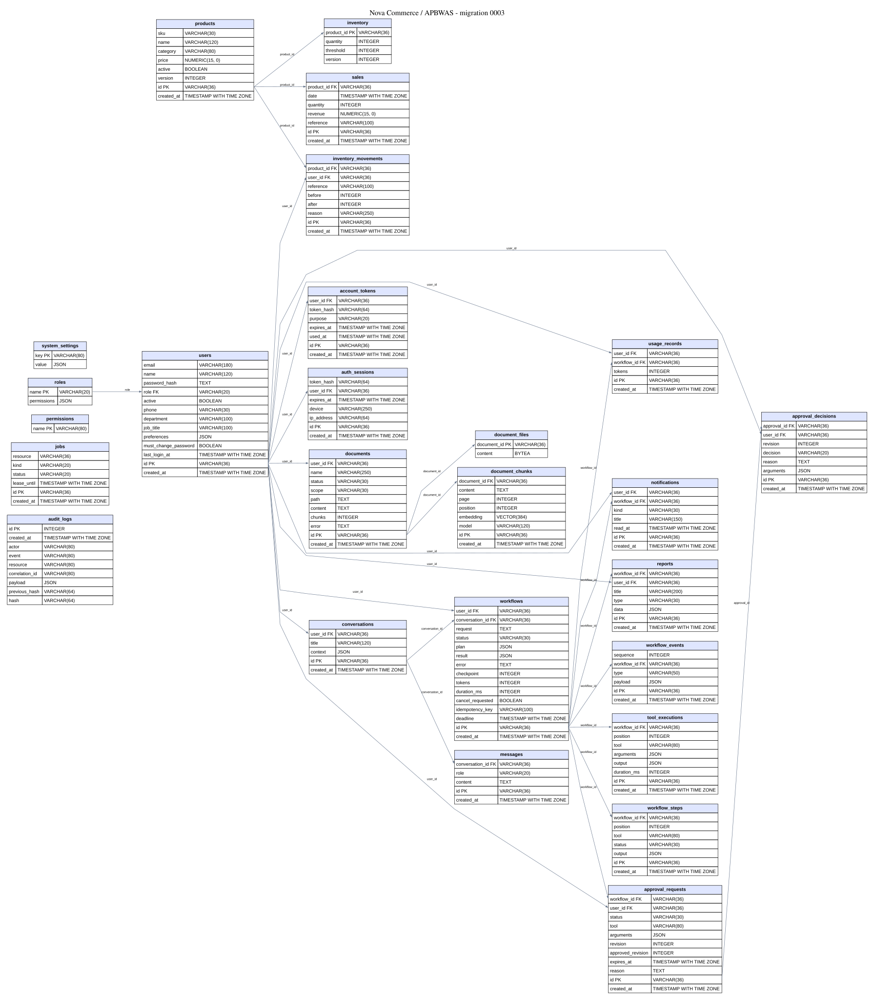

# Database design — Nova Commerce / APBWAS, migration 0003

26 tables · 178 columns · 27 foreign keys.

Generated from SQLAlchemy metadata; no business data or secrets are exported. Historical DOCX version 1.1 describes migration 0002 and is retained as an earlier revision.

## Storage rules

- PostgreSQL stores employee profiles, hashed passwords/session/recovery tokens, preferences, company settings, conversations, workflow state, notifications, sales, stock movements, audit, extracted text, vectors and original document bytes.
- Passwords are Argon2 hashes; opaque access tokens are SHA256 hashes. Raw activation links are shown once to the authorized administrator.
- Runtime API keys and the audit signing key remain server environment secrets. Temporary initial account passwords are delivered through a private, ignored file.
- A sale, inventory decrement, version increment, movement and audit commit atomically. Product and inventory versions are separate fields.
- Agent inventory changes retain human approval. Business sales are explicit human operations with permission checks and idempotency references.
- Legacy upload originals are copied into document_files during initialization, without deleting the original volume.
- Roles store permission assignments as JSON; permissions is a catalog, not a many-to-many join table.

## audit_logs

| Column | PostgreSQL type | Null | Keys |
|---|---|---|---|
| id | INTEGER | no | PK |
| created_at | TIMESTAMP WITH TIME ZONE | no |  |
| actor | VARCHAR(80) | no |  |
| event | VARCHAR(80) | no |  |
| resource | VARCHAR(80) | no |  |
| correlation_id | VARCHAR(80) | no |  |
| payload | JSON | no |  |
| previous_hash | VARCHAR(64) | no |  |
| hash | VARCHAR(64) | no |  |

## jobs

| Column | PostgreSQL type | Null | Keys |
|---|---|---|---|
| resource | VARCHAR(36) | no | UQ |
| kind | VARCHAR(20) | no |  |
| status | VARCHAR(20) | no |  |
| lease_until | TIMESTAMP WITH TIME ZONE | yes |  |
| id | VARCHAR(36) | no | PK |
| created_at | TIMESTAMP WITH TIME ZONE | no |  |

## permissions

| Column | PostgreSQL type | Null | Keys |
|---|---|---|---|
| name | VARCHAR(80) | no | PK |

## products

| Column | PostgreSQL type | Null | Keys |
|---|---|---|---|
| sku | VARCHAR(30) | no | UQ |
| name | VARCHAR(120) | no |  |
| category | VARCHAR(80) | no |  |
| price | NUMERIC(15, 0) | no |  |
| active | BOOLEAN | no |  |
| version | INTEGER | no |  |
| id | VARCHAR(36) | no | PK |
| created_at | TIMESTAMP WITH TIME ZONE | no |  |

## roles

| Column | PostgreSQL type | Null | Keys |
|---|---|---|---|
| name | VARCHAR(20) | no | PK |
| permissions | JSON | no |  |

## system_settings

| Column | PostgreSQL type | Null | Keys |
|---|---|---|---|
| key | VARCHAR(80) | no | PK |
| value | JSON | no |  |

## inventory

| Column | PostgreSQL type | Null | Keys |
|---|---|---|---|
| product_id | VARCHAR(36) | no | PK, FK products.id |
| quantity | INTEGER | no |  |
| threshold | INTEGER | no |  |
| version | INTEGER | no |  |

## sales

| Column | PostgreSQL type | Null | Keys |
|---|---|---|---|
| product_id | VARCHAR(36) | no | FK products.id |
| date | TIMESTAMP WITH TIME ZONE | no |  |
| quantity | INTEGER | no |  |
| revenue | NUMERIC(15, 0) | no |  |
| reference | VARCHAR(100) | yes | UQ |
| id | VARCHAR(36) | no | PK |
| created_at | TIMESTAMP WITH TIME ZONE | no |  |

## users

| Column | PostgreSQL type | Null | Keys |
|---|---|---|---|
| email | VARCHAR(180) | no | UQ |
| name | VARCHAR(120) | no |  |
| password_hash | TEXT | no |  |
| role | VARCHAR(20) | no | FK roles.name |
| active | BOOLEAN | no |  |
| phone | VARCHAR(30) | no |  |
| department | VARCHAR(100) | no |  |
| job_title | VARCHAR(100) | no |  |
| preferences | JSON | no |  |
| must_change_password | BOOLEAN | no |  |
| last_login_at | TIMESTAMP WITH TIME ZONE | yes |  |
| id | VARCHAR(36) | no | PK |
| created_at | TIMESTAMP WITH TIME ZONE | no |  |

## account_tokens

| Column | PostgreSQL type | Null | Keys |
|---|---|---|---|
| user_id | VARCHAR(36) | no | FK users.id |
| token_hash | VARCHAR(64) | no | UQ |
| purpose | VARCHAR(20) | no |  |
| expires_at | TIMESTAMP WITH TIME ZONE | no |  |
| used_at | TIMESTAMP WITH TIME ZONE | yes |  |
| id | VARCHAR(36) | no | PK |
| created_at | TIMESTAMP WITH TIME ZONE | no |  |

## auth_sessions

| Column | PostgreSQL type | Null | Keys |
|---|---|---|---|
| token_hash | VARCHAR(64) | no | UQ |
| user_id | VARCHAR(36) | no | FK users.id |
| expires_at | TIMESTAMP WITH TIME ZONE | no |  |
| device | VARCHAR(250) | no |  |
| ip_address | VARCHAR(64) | no |  |
| id | VARCHAR(36) | no | PK |
| created_at | TIMESTAMP WITH TIME ZONE | no |  |

## conversations

| Column | PostgreSQL type | Null | Keys |
|---|---|---|---|
| user_id | VARCHAR(36) | no | FK users.id |
| title | VARCHAR(120) | no |  |
| context | JSON | no |  |
| id | VARCHAR(36) | no | PK |
| created_at | TIMESTAMP WITH TIME ZONE | no |  |

## documents

| Column | PostgreSQL type | Null | Keys |
|---|---|---|---|
| user_id | VARCHAR(36) | no | FK users.id |
| name | VARCHAR(250) | no |  |
| status | VARCHAR(30) | no |  |
| scope | VARCHAR(30) | no |  |
| path | TEXT | yes |  |
| content | TEXT | no |  |
| chunks | INTEGER | no |  |
| error | TEXT | yes |  |
| id | VARCHAR(36) | no | PK |
| created_at | TIMESTAMP WITH TIME ZONE | no |  |

## inventory_movements

| Column | PostgreSQL type | Null | Keys |
|---|---|---|---|
| product_id | VARCHAR(36) | no | FK products.id |
| user_id | VARCHAR(36) | no | FK users.id |
| reference | VARCHAR(100) | no | UQ |
| before | INTEGER | no |  |
| after | INTEGER | no |  |
| reason | VARCHAR(250) | no |  |
| id | VARCHAR(36) | no | PK |
| created_at | TIMESTAMP WITH TIME ZONE | no |  |

## document_chunks

| Column | PostgreSQL type | Null | Keys |
|---|---|---|---|
| document_id | VARCHAR(36) | no | FK documents.id |
| content | TEXT | no |  |
| page | INTEGER | yes |  |
| position | INTEGER | no |  |
| embedding | VECTOR(384) | no |  |
| model | VARCHAR(120) | no |  |
| id | VARCHAR(36) | no | PK |
| created_at | TIMESTAMP WITH TIME ZONE | no |  |

## document_files

| Column | PostgreSQL type | Null | Keys |
|---|---|---|---|
| document_id | VARCHAR(36) | no | PK, FK documents.id |
| content | BYTEA | no |  |

## messages

| Column | PostgreSQL type | Null | Keys |
|---|---|---|---|
| conversation_id | VARCHAR(36) | no | FK conversations.id |
| role | VARCHAR(20) | no |  |
| content | TEXT | no |  |
| id | VARCHAR(36) | no | PK |
| created_at | TIMESTAMP WITH TIME ZONE | no |  |

## workflows

| Column | PostgreSQL type | Null | Keys |
|---|---|---|---|
| user_id | VARCHAR(36) | no | FK users.id |
| conversation_id | VARCHAR(36) | yes | FK conversations.id |
| request | TEXT | no |  |
| status | VARCHAR(30) | no |  |
| plan | JSON | no |  |
| result | JSON | no |  |
| error | TEXT | yes |  |
| checkpoint | INTEGER | no |  |
| tokens | INTEGER | no |  |
| duration_ms | INTEGER | no |  |
| cancel_requested | BOOLEAN | no |  |
| idempotency_key | VARCHAR(100) | no | UQ |
| deadline | TIMESTAMP WITH TIME ZONE | yes |  |
| id | VARCHAR(36) | no | PK |
| created_at | TIMESTAMP WITH TIME ZONE | no |  |

## approval_requests

| Column | PostgreSQL type | Null | Keys |
|---|---|---|---|
| workflow_id | VARCHAR(36) | no | UQ, FK workflows.id |
| user_id | VARCHAR(36) | no | FK users.id |
| status | VARCHAR(30) | no |  |
| tool | VARCHAR(80) | no |  |
| arguments | JSON | no |  |
| revision | INTEGER | no |  |
| approved_revision | INTEGER | yes |  |
| expires_at | TIMESTAMP WITH TIME ZONE | no |  |
| reason | TEXT | no |  |
| id | VARCHAR(36) | no | PK |
| created_at | TIMESTAMP WITH TIME ZONE | no |  |

## notifications

| Column | PostgreSQL type | Null | Keys |
|---|---|---|---|
| user_id | VARCHAR(36) | no | FK users.id |
| workflow_id | VARCHAR(36) | no | FK workflows.id |
| kind | VARCHAR(30) | no |  |
| title | VARCHAR(150) | no |  |
| read_at | TIMESTAMP WITH TIME ZONE | yes |  |
| id | VARCHAR(36) | no | PK |
| created_at | TIMESTAMP WITH TIME ZONE | no |  |

## reports

| Column | PostgreSQL type | Null | Keys |
|---|---|---|---|
| workflow_id | VARCHAR(36) | no | UQ, FK workflows.id |
| user_id | VARCHAR(36) | no | FK users.id |
| title | VARCHAR(200) | no |  |
| type | VARCHAR(30) | no |  |
| data | JSON | no |  |
| id | VARCHAR(36) | no | PK |
| created_at | TIMESTAMP WITH TIME ZONE | no |  |

## tool_executions

| Column | PostgreSQL type | Null | Keys |
|---|---|---|---|
| workflow_id | VARCHAR(36) | no | FK workflows.id |
| position | INTEGER | no |  |
| tool | VARCHAR(80) | no |  |
| arguments | JSON | no |  |
| output | JSON | no |  |
| duration_ms | INTEGER | no |  |
| id | VARCHAR(36) | no | PK |
| created_at | TIMESTAMP WITH TIME ZONE | no |  |

## usage_records

| Column | PostgreSQL type | Null | Keys |
|---|---|---|---|
| user_id | VARCHAR(36) | no | FK users.id |
| workflow_id | VARCHAR(36) | no | UQ, FK workflows.id |
| tokens | INTEGER | no |  |
| id | VARCHAR(36) | no | PK |
| created_at | TIMESTAMP WITH TIME ZONE | no |  |

## workflow_events

| Column | PostgreSQL type | Null | Keys |
|---|---|---|---|
| sequence | INTEGER | no | UQ |
| workflow_id | VARCHAR(36) | no | FK workflows.id |
| type | VARCHAR(50) | no |  |
| payload | JSON | no |  |
| id | VARCHAR(36) | no | PK |
| created_at | TIMESTAMP WITH TIME ZONE | no |  |

## workflow_steps

| Column | PostgreSQL type | Null | Keys |
|---|---|---|---|
| workflow_id | VARCHAR(36) | no | FK workflows.id |
| position | INTEGER | no |  |
| tool | VARCHAR(80) | no |  |
| status | VARCHAR(30) | no |  |
| output | JSON | no |  |
| id | VARCHAR(36) | no | PK |
| created_at | TIMESTAMP WITH TIME ZONE | no |  |

## approval_decisions

| Column | PostgreSQL type | Null | Keys |
|---|---|---|---|
| approval_id | VARCHAR(36) | no | FK approval_requests.id |
| user_id | VARCHAR(36) | no | FK users.id |
| revision | INTEGER | no |  |
| decision | VARCHAR(20) | no |  |
| reason | TEXT | no |  |
| arguments | JSON | no |  |
| id | VARCHAR(36) | no | PK |
| created_at | TIMESTAMP WITH TIME ZONE | no |  |
